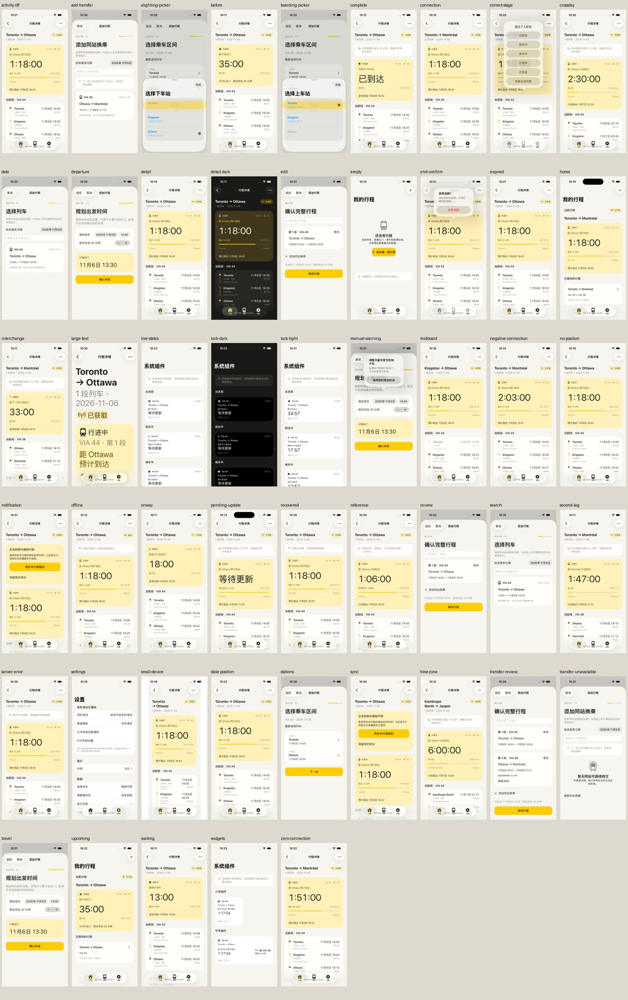
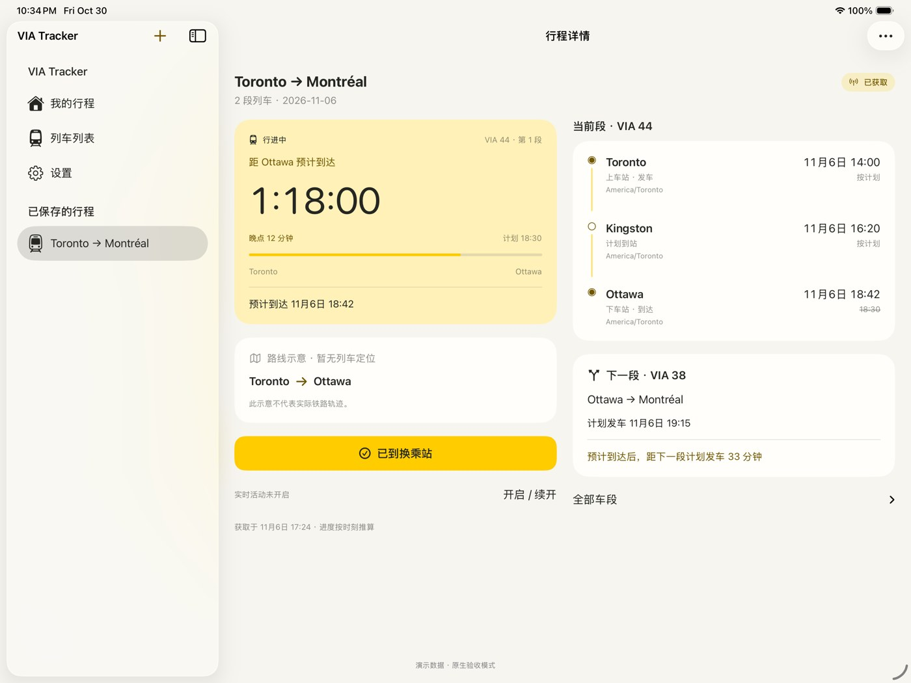

# Implementation and verification history

This record summarizes the 31 October 2026 development checkpoint. [Latest validation](RELEASE_VALIDATION.md) supersedes its test counts and deployment versions.

## Historical evidence

| Area | Observed result |
| --- | --- |
| Shared Swift core | Seven test groups passed, including 12 shared Swift/TypeScript projection fixtures |
| Backend and contract | Type checking and 22 tests passed; OpenAPI 3.1 parsing and AJV validation passed |
| Local integration | Twelve scenario groups passed with Postman stand-ins and local Wrangler/D1 |
| iPhone interaction | Creation, intermediate boarding, zero travel time, editing, saving, phase correction, completion, offline relaunch and formal-schedule choice passed |
| Native layout | Largest-text control reachability and iPad landscape UI tests passed; 50 phone and five tablet scenarios captured |
| Builds | Simulator app/widget build and development-signed archive/export succeeded |
| Live data | List/detail 200, conditional 304, advancing snapshots and a native refresh with 68 valid instances |
| APNs transport | Probe returned `BadDeviceToken`; real device/topic delivery was not established |

Integration covered source failure and empty-response retention, installation isolation, revision conflict, station validation, APNs retry, token invalidation, monotonic timestamps, expiry, future matching and idempotent deletion. Domain cases included multi-date identity, intermediate boarding, missing events, dates/time zones/DST, negative intervals and old responses.

Weak ETag comparison was added after observing Cloudflare response transformation. The app owns ETags and persistent snapshots and bypasses URLCache for feed requests. Cancellation on background entry is not displayed as an update failure.

## Native evidence

The [UI matrix](UI_MATRIX.md) preserves all 56 design scenario IDs. Debug capture mode uses isolated fixtures. Gallery views reuse real extension content but do not establish system-hosted Lock Screen, Island, banner or widget-timeline rendering.

[Phone detail](verification/iphone-detail.jpg), [dark mode](verification/iphone-dark.jpg), [planning](verification/planning.jpg), [formal matching](verification/sync-choice.jpg), [largest text](verification/largest-text.jpg), [reachable controls](verification/largest-text-controls.jpg), [iPad narrow container](verification/ipad-narrow.jpg), [widget gallery](verification/widgets-gallery.jpg), [real service](verification/real-service-feed.jpg).

A 320-point or 600-point container is not a real device/window-resize test. Follow [device QA](DEVICE_QA.md) for push delivery, system lifecycle, long-running renewal, VoiceOver and actual tablet resizing. Logs and original QA captures are local ignored artifacts.
